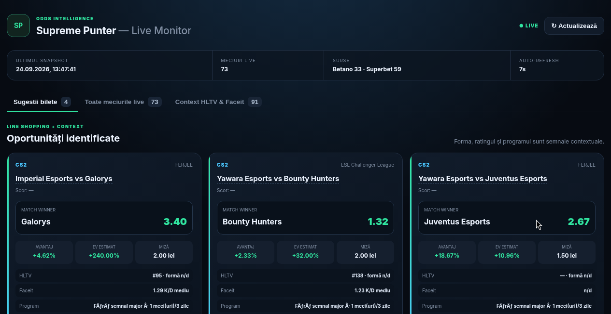
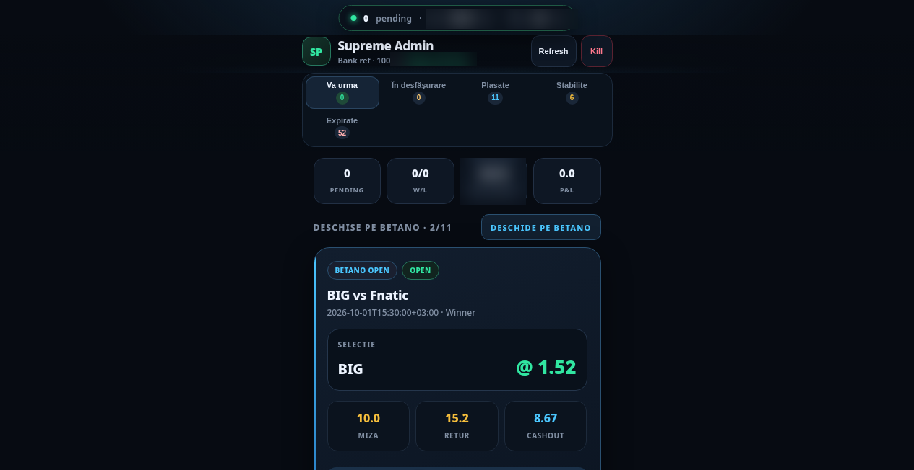
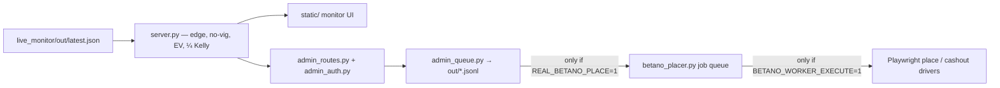

<div align="center">

<div style="font-size:64px">🎯</div>

# Supreme Punter — betting tips dashboard

**Local odds line-shopping with honest math, tiny capped stakes and a human in the loop.**

  <a href="https://betting-tips-demo.vercel.app"></a>
  <a href="https://github.com/LucianCeusanRo/betting-tips-dashboard/actions/workflows/ci.yml"></a>
  <a href="LICENSE"></a>
  
  <a href="https://github.com/LucianCeusanRo/betting-tips-dashboard/stargazers"></a>
  <a href="https://github.com/LucianCeusanRo/betting-tips-dashboard/commits/main"></a>

[English](#-about) · [Română](#-română)

</div>

<p align="center"></p>

<p align="center"><strong><a href="https://betting-tips-demo.vercel.app">▶ Live demo</a></strong> — open it in the browser and try it yourself.</p>

## 📑 Table of contents

- [📖 About](#-about)
- [✨ Features](#-features)
- [🧠 How it works](#-how-it-works)
- [⚡ Quick start](#-quick-start)
- [📚 Step-by-step tutorial](#-step-by-step-tutorial)
- [🔧 Configuration](#-configuration)
- [🗂️ Project structure](#-project-structure)
- [⚠️ Limitations](#-limitations)
- [❓ FAQ](#-faq)
- [🗺️ Roadmap](#-roadmap)
- [🤝 Contributing](#-contributing)
- [📄 License](#-license)
- [🇷🇴 Română](#-română)
- [👤 Author](#-author)

## 📖 About

A local **FastAPI** dashboard I built for myself to compare live odds between two Romanian bookmakers (Betano and Superbet), flag the few bets where one book pays noticeably more than the other, size a small stake, and send each suggestion through a **human-approval admin console** before anything happens.

- **What:** a read-only "line shopping" monitor + an admin queue for tip approval. Mostly CS2 / esports and football matches.
- **What it is used for:** instead of opening two betting sites and comparing odds by hand, the monitor reads one JSON snapshot of live matches, computes the edge between the two books and shows only the opportunities above a threshold, with a stake capped at 2 lei.
- **Who it helps:** anyone who wants to learn/experiment with odds math (no-vig probability, expected value, fractional Kelly) on real data, with strict small-bank limits and a person in the loop.
- **What it is NOT:** not a "sure win" system and not a bot that bets on its own. Every estimate is shown with a disclaimer; real placement is disabled by default and needs several explicit env switches.

## ✨ Features

- ✨ **Live monitor** (`/`): tabs *Bet suggestions*, *All live matches*, *HLTV & Faceit context*; auto-refresh.
- 🔎 **Odds math** (`server.py`): best price vs. the other book → `edge %`; probability without the bookmaker margin (no-vig) from the reference book → `EV %`; stake = ¼ Kelly on a 100 lei reference bank, capped at **2 lei**, minimum edge **2 %**.
- ⚙️ **Context**: HLTV rank and Faceit K/D from local caches, plus a "fatigue" signal (matches played in the last 3 days, from snapshot history) that slightly lowers the ranking.
- 📊 **Admin console** (`/admin`): login page, tabs *Coming up / Live / Placed / Settled / Expired*, per-ticket Confirm / Skip / Re-check odds, a daily **Kill / halt** switch, today's history and P&L, multi-leg ticket simulation (Monte Carlo in `multi_ticket.py`), auto-expiry of tickets whose match already started.
- 🛡️ **Safety gates**: `REAL_BETANO_PLACE`, `BETANO_WORKER_EXECUTE`, `BETANO_CASHOUT_EXECUTE` all default to `0`. With them off, *Confirm* only writes a dry-run job to a JSONL queue. Cash-out is manual by default.
- 🧩 **Optional Playwright drivers**: keep a Betano/Superbet browser session alive, read open/settled bets, and (only when explicitly enabled) place or cash out a confirmed ticket.



## 🧠 How it works



For each match the best price is compared with the other book; probability comes from the reference book with the margin removed; stake = ¼ Kelly on a 100 lei reference bank, capped at 2 lei. Every suggestion waits in the admin queue for Confirm or Skip; by default Confirm only writes a dry-run job.

**Tech stack:** Python 3.11+, FastAPI, Uvicorn, Jinja2, HTML/CSS/JS, JSON/JSONL storage, Playwright (optional).

## ⚡ Quick start

```bash
git clone https://github.com/LucianCeusanRo/betting-tips-dashboard.git && cd betting-tips-dashboard
python -m venv .venv && .venv/bin/pip install -r requirements.txt
cp .env.example .env            # set ADMIN_USER / ADMIN_PASSWORD, export them
mkdir -p live_monitor/out && cp examples/latest.sample.json live_monitor/out/latest.json
uvicorn live_dashboard.main:app --port 8765    # http://127.0.0.1:8765
```

## 📚 Step-by-step tutorial

### 1. Install
```bash
git clone https://github.com/LucianCeusanRo/betting-tips-dashboard.git
cd betting-tips-dashboard
python -m venv .venv && source .venv/bin/activate      # Windows: .venv\Scripts\activate
pip install -r requirements.txt
# optional, only for the browser drivers:
python -m playwright install chromium
```

### 2. Configure `.env`
```bash
cp .env.example .env
```
Set at least `ADMIN_USER` and `ADMIN_PASSWORD` (if they are empty the admin login is disabled). Leave every `*_EXECUTE` / `REAL_BETANO_PLACE` at `0` while you learn. Bookmaker credentials are only needed for the optional session drivers. Load the file into your shell (`set -a; source .env; set +a`) or use your process manager.

### 3. Give it data
The monitor reads `live_monitor/out/latest.json`. The scraper that produces it is not part of this repo, so start with the sample:
```bash
mkdir -p live_monitor/out
cp examples/latest.sample.json live_monitor/out/latest.json
```
Format: `matches[]` with `teams`, `sport`, `league` and `books.betano / books.superbet → markets.match_winner.selections[{name, price}]`.

### 4. Run
```bash
uvicorn live_dashboard.main:app --host 127.0.0.1 --port 8765
```
- Monitor: http://127.0.0.1:8765/
- API docs: http://127.0.0.1:8765/docs
- Admin: http://127.0.0.1:8765/admin

### 5. Typical walkthrough
1. Open the monitor → tab **Bet suggestions**. With the sample you get two cards: for each, the book with the better price, the reference price, edge %, EV % and a stake of max 2 lei.
2. Open **HLTV & Faceit context** to see rank/form/fatigue for the teams (empty until you add the caches).
3. Log in at `/admin`. New suggestions appear in **Coming up**. Press **Re-check** to compare against fresh odds, then **Confirm** (dry-run job) or **Skip**.
4. Press **Kill** if you want to stop everything for the rest of the day.
5. Run the tests: `BETANO_PLACER_SIMULATE=1 python tests/test_betano_placer.py`.

## 🔧 Configuration

Copy `.env.example` to `.env`. All safety switches default to off.

| Variable | Required | What it does |
|---|---|---|
| `ADMIN_USER / ADMIN_PASSWORD` | yes | admin console login (empty = login disabled) |
| `ADMIN_ACCESS_TOKEN` | no | fixed session token; otherwise generated in `live_dashboard/out/` |
| `BETANO_USER / BETANO_EMAIL / BETANO_PASSWORD` | no | only for the optional session/placer drivers |
| `SUPERBET_USER / SUPERBET_EMAIL / SUPERBET_PASSWORD` | no | optional Superbet session driver |
| `BETANO_PROXY / SUPERBET_PROXY / EGRESS_PROXY_ADDR` | no | optional HTTP proxy |
| `REAL_BETANO_PLACE` | no (0) | 1 = Confirm enqueues real place jobs |
| `BETANO_WORKER_EXECUTE` | no (0) | 1 = worker may drive the browser |
| `BETANO_CASHOUT_EXECUTE` | no (0) | 1 = allow automatic cash-out (manual by default) |
| `BETANO_PLACER_SIMULATE` | no (1) | complete jobs with fake ids (tests) |
| `BETANO_COOKIE_DIR / SUPERBET_COOKIE_DIR` | no | where browser session state is kept (git-ignored `state/`) |

## 🗂️ Project structure

```
live_dashboard/
  server.py              read-only monitor + odds math (/api/live, /api/tips, /api/context)
  main.py                app = monitor + admin router
  admin_auth.py          env-based login, session token
  admin_routes.py        /admin pages and /api/admin/* endpoints
  admin_queue.py         ticket queue, statuses, halt switch, history (JSONL in out/)
  multi_ticket.py        multi-leg probability / Monte Carlo simulation
  betano_placer.py       job queue with safety gates
  betano_place_web.py, betano_cashout_web.py   Playwright drivers (opt-in)
  betano_session.py, superbet_session.py       session keep-alive (no betting)
  static/                monitor UI;  templates/  admin login + console
examples/latest.sample.json   demo snapshot
tests/                   script-style tests (run with python)
docs/screenshots/        images used here (balances blurred)
```

## ⚠️ Limitations

- The odds **scraper** (`live_monitor`), the tip store / notifier (`tip_store`, `tip_gate`), the dry-run worker (`dry_run_placer`) and the OTP inbox module (`otp_inbox`) are not included, so `/admin/otp`, store sync and `tests/test_admin_console.py` need your own implementation.
- Only two books (Betano RO, Superbet RO) and only "winner" markets are compared.
- Probabilities are estimates from bookmaker prices; nothing here guarantees profit. Bookmaker websites change often, so the Playwright selectors can break. Bookmakers may geo-block non-Romanian IPs.
- Gambling is for adults (18+) only and can be addictive. Use small amounts and check your local law. Automated betting may break a bookmaker's terms — that is why real placement is off by default.

---

## ❓ FAQ

<details><summary><b>Does it bet automatically?</b></summary>

Not by default. Real placement needs `REAL_BETANO_PLACE=1` **and** `BETANO_WORKER_EXECUTE=1`, plus a confirmed ticket.

</details>

<details><summary><b>Is profit guaranteed?</b></summary>

No. Probabilities are estimates from bookmaker prices; every card carries a disclaimer.

</details>

<details><summary><b>Where does the odds data come from?</b></summary>

From a separate scraper (not included) that writes `latest.json`; use the sample to try it.

</details>

<details><summary><b>Is gambling legal for me?</b></summary>

Check your local law; adults (18+) only. Bet small and stop if it stops being fun.

</details>

## 🗺️ Roadmap

- [ ] Publish a minimal open scraper for the snapshot format
- [ ] Unit tests for the odds math
- [ ] More markets than match winner

## 🤝 Contributing

Issues and pull requests are welcome. Please keep changes small, describe how you tested them, and never commit real credentials — use `.env` (git-ignored) and update `.env.example` with placeholders only.

## 📄 License

MIT — see [LICENSE](LICENSE).

## 🇷🇴 Română

<details>
<summary><b>Click pentru versiunea în limba română</b></summary>

Un dashboard local **FastAPI** făcut pentru mine, care compară cotele live între Betano și Superbet, scoate în evidență pariurile unde o casă plătește vizibil mai mult decât cealaltă, calculează o miză mică și trece fiecare sugestie printr-o **consolă de admin cu aprobare manuală**.

#### Ce este și la ce folosește
- **Ce:** un monitor read-only de „line shopping” + o coadă de aprobare pentru bilete. Mai ales CS2 / esports și fotbal.
- **La ce folosește:** în loc să compari cotele manual pe două site-uri, monitorul citește un snapshot JSON cu meciurile live, calculează avantajul dintre case și arată doar oportunitățile peste prag, cu miză de maximum 2 lei.
- **Pe cine ajută:** pe cine vrea să învețe matematica cotelor (probabilitate fără marjă, valoare așteptată, Kelly fracționat) pe date reale, cu limite stricte și om în buclă.
- **Ce NU este:** nu e un sistem „sigur” și nu e un bot care pariază singur. Plasarea reală e oprită implicit.

#### Funcționalități
- **Monitor live** (`/`): taburi *Sugestii bilete*, *Toate meciurile live*, *Context HLTV & Faceit*; refresh automat.
- **Calcul**: cea mai bună cotă vs. cealaltă casă → `avantaj %`; probabilitate fără marjă → `EV %`; miză = ¼ Kelly pe o bancă de referință de 100 lei, plafon **2 lei**, avantaj minim **2 %**.
- **Context**: rank HLTV, K/D Faceit din cache local, „oboseală” (meciuri în ultimele 3 zile) care scade puțin scorul.
- **Consolă admin** (`/admin`): login, taburi *Va urma / În desfășurare / Plasate / Stabilite / Expirate*, Confirmă / Skip / Re-verifică cota, buton **Kill** pe zi, istoric și P&L, simulare bilete multiple (Monte Carlo), expirare automată.
- **Siguranță**: `REAL_BETANO_PLACE`, `BETANO_WORKER_EXECUTE`, `BETANO_CASHOUT_EXECUTE` sunt `0` implicit — *Confirmă* scrie doar un job de test (dry-run). Cash-out-ul e manual.
- **Drivere Playwright opționale**: păstrează sesiunea Betano/Superbet, citește biletele deschise/stabilite și, doar dacă activezi explicit, plasează sau încasează un bilet confirmat.

#### Arhitectură și tehnologii
Vezi diagrama de mai sus. Python 3.11+, FastAPI, Uvicorn, Jinja2, HTML/CSS/JS simplu, fișiere JSON/JSONL, Playwright (opțional).

#### Tutorial
1. **Instalare:** `git clone …`, `python -m venv .venv`, `pip install -r requirements.txt` (opțional `python -m playwright install chromium`).
2. **Configurare:** `cp .env.example .env`, completează `ADMIN_USER` și `ADMIN_PASSWORD` (goale = login dezactivat). Lasă comutatoarele `*_EXECUTE` pe `0`.
3. **Date:** `mkdir -p live_monitor/out && cp examples/latest.sample.json live_monitor/out/latest.json` (scraperul nu e inclus).
4. **Pornire:** `uvicorn live_dashboard.main:app --host 127.0.0.1 --port 8765` → monitor la `/`, documentație API la `/docs`, admin la `/admin`.
5. **Utilizare:** tabul *Sugestii bilete* arată cardurile cu cotă, avantaj, EV și miză; în `/admin` biletele noi apar în *Va urma* → *Re-verifică* → *Confirmă* sau *Skip*; *Kill* oprește tot pentru ziua curentă. Teste: `BETANO_PLACER_SIMULATE=1 python tests/test_betano_placer.py`.

#### Structura proiectului
Vezi lista de mai sus (`live_dashboard/`, `examples/`, `tests/`, `docs/screenshots/`).

#### Limitări
- Scraperul de cote (`live_monitor`), `tip_store`/`tip_gate`, `dry_run_placer` și `otp_inbox` nu sunt incluse — `/admin/otp`, sincronizarea și `tests/test_admin_console.py` cer implementarea ta.
- Doar două case (Betano RO, Superbet RO) și doar piețele „câștigător”.
- Probabilitățile sunt estimări; nu există profit garantat. Site-urile se schimbă, deci selectorii Playwright se pot strica.
- Pariurile sunt doar pentru 18+ și pot crea dependență. Pariatul automat poate încălca termenii caselor — de aceea plasarea reală e oprită implicit.

</details>

## 👤 Author

**Lucian-Ciprian Ceușan** — telecom & network technician, Bucharest, Romania

[](https://lucian-ceusan.vercel.app) [](https://www.linkedin.com/in/lucian-ceusan-7a9179210) [](https://github.com/LucianCeusanRo)
